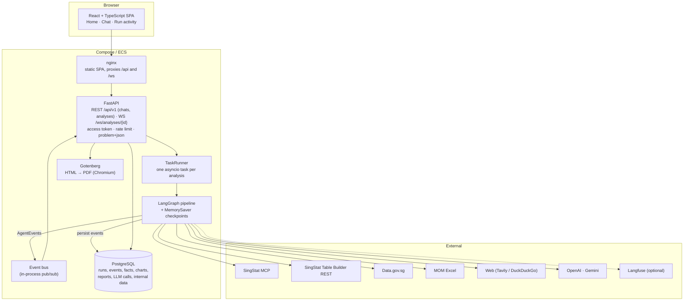
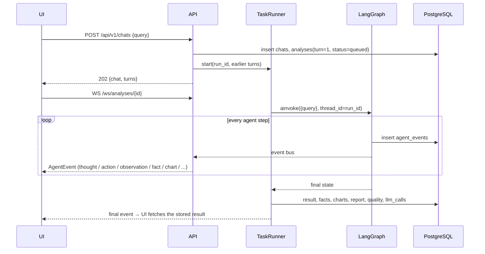
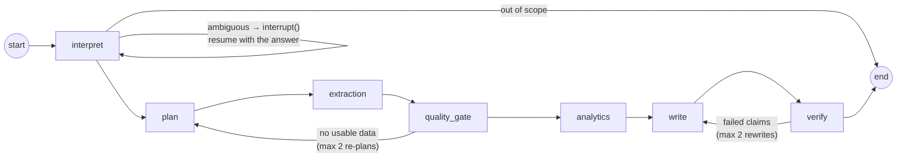
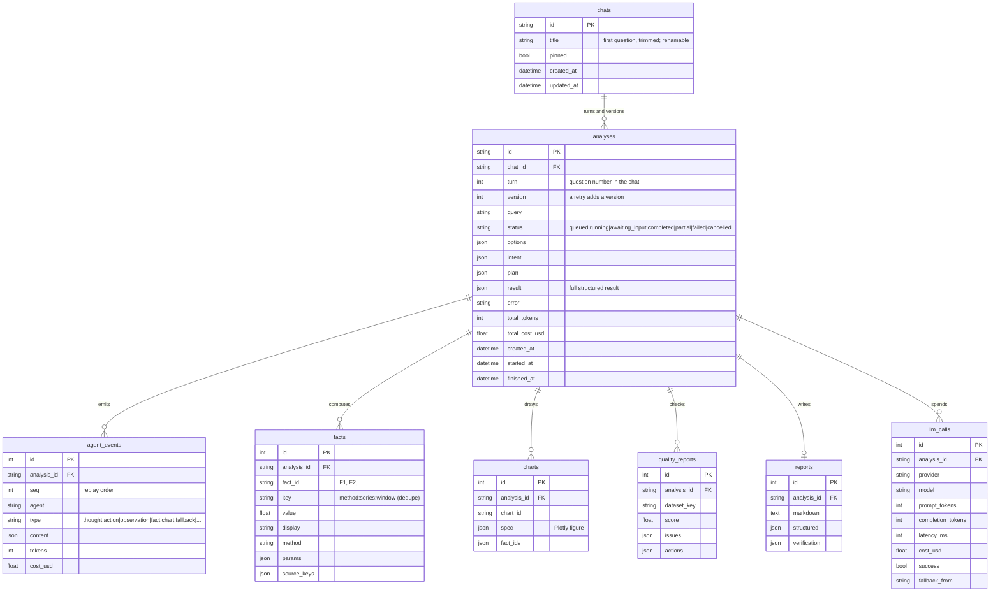
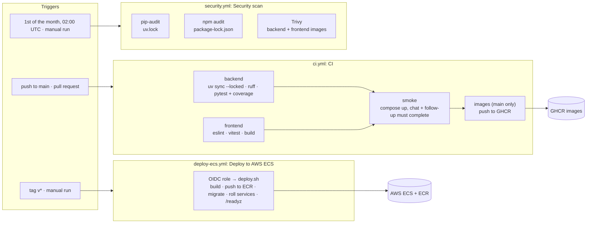

# Architecture

> **About this file:** how the platform is built: components, agents and the LangGraph pipeline, data flow,
> LLM routing, hallucination controls, failure handling, database schema, design trade-offs and the
> CI/CD pipeline. For running and deploying it see [DEPLOYMENT.md](DEPLOYMENT.md); for tests see [TESTING.md](TESTING.md).

## 1. Components

The UI is a chat. The first question creates a chat (`POST /api/v1/chats`); each follow-up
(`POST /chats/{id}/messages`) or retry (`POST /chats/{id}/turns/{n}/retry`) adds a turn to it. Every turn
is one analysis run: the API stores an `analyses` row (with its chat, turn and version) and hands the run to
the `TaskRunner`, which executes the graph as a background asyncio task, and the API returns 202 immediately.
`POST /api/v1/analyses` still works for a single run and creates a one-question chat. Every
step the agents take is emitted as an `AgentEvent`. Each event is persisted to `agent_events` and
published on the bus, and the WebSocket relays it to the browser. A client that reconnects replays
missed events with `GET /events?after=<seq>`, so the timeline never has gaps.

## 2. Agents and the graph

| Agent (node) | Responsibility | How it decides |
|---|---|---|
| **Coordinator** (`interpret`, `plan`, `quality_gate`) | Turns the query into a `ResearchIntent` (sectors, metrics, years, analysis types, web need, confidence). Pauses with `interrupt()` and suggested refinements when the query is ambiguous. Builds a `ResearchPlan` of tasks per source. Re-plans with broader terms when no usable data comes back | Structured LLM output (strong model tier); the quality gate is deterministic |
| **Extraction** (`extraction`) | ReAct loop (up to 18 steps) over 12 tools: SingStat search, metadata and fetch; Data.gov.sg search and fetch; MOM Excel; internal SQL; web search, fetch and extract. Every fetch is normalised, quality-checked and cleaned before the agent sees the result | One `ReActStep` per turn (fast tier): thought, action, JSON arguments |
| **Analytics** (`analytics`) | ReAct loop (up to 24 steps) over deterministic tools: `annualise`, `describe`, `change`, `cagr`, `yoy`, `trend`, `share`, `correlate`, `anomalies`, `forecast`, `make_chart`. Each tool returns numbered Facts | The model picks which analyses suit the intent; it never computes |
| **Report Writer** (`write`) | Drafts the report as claims, each with `fact_ids` and `source_keys`; rewrites using the verifier's feedback | Strong tier; prompt forbids any number not copied from a Fact |
| **Verifier** (`verify`) | Deterministic checks on every claim (section 5); failing claims go back to the writer, and after 2 rewrites they are dropped and listed under Limitations | No LLM involved |

**ReAct loop** (`agents/react.py`): each turn the model returns a structured `ReActStep`
`{thought, action, action_input_json, final_answer}`. The loop validates the arguments against the tool's
Pydantic schema, runs the tool, truncates the observation and feeds it back. Tool errors come back as
observations, so the agent can recover by trying another table or source. Exceeding the step budget
forces a finish with partial results and a warning event. A JSON step format, rather than
provider-native tool calling, keeps the loop identical on OpenAI, Gemini and the MockLLM, and makes the
thought an explicit field the UI can show.

**Follow-up questions**: a follow-up turn receives the earlier turns of its chat (`runner/followup.py`).
Their text feeds `interpret` and `write`, so "what about finance?" inherits the sector, metric and years.
Earlier facts are carried over and flagged, and while the earlier runs are still in memory (the last 25),
their datasets are too, so `fetch_singstat` reuses a table that already covers the request and fetches
only what is new. Suggested follow-up questions are built deterministically from the answered intent
(`agents/suggestions.py`), with no LLM call.

**State split**: LangGraph state holds only small, serialisable values (intent, plan, counters, feedback).
DataFrames, Facts and charts live in a per-run `RunContext`, so checkpoints stay small and a clarification
interrupt can resume the same run with its data intact.

**MockLLM**: with no keys, each LLM call site supplies a scripted policy (`agents/mock_policies.py`) that
decides from the run's real data, e.g. "pick the annual table whose title matches the metric". The
offline demo and the tests therefore exercise every real tool, check and fallback. Only the LLM's
choices are scripted.

## 3. Data flow and the canonical format

All sources normalise to one long format, `CANONICAL_COLUMNS = [source_id, dataset_id, series,
series_code, period, period_start, frequency, value, unit]`, so analytics only has to handle one shape.
Each `DatasetRecord` carries provenance: URL, retrieval time, fallback flag and reason, trust tier,
agency and footnote. A Fact's `source_keys` point back to those records, and report citations are
generated from them.

Data quality (`quality/checks.py`) runs on every fetch. It checks schema, completeness, duplicates,
validity (no negative counts, percentages within [-100, 100]), coverage of the requested years,
parent-vs-children consistency for SingStat's hierarchical series codes, provenance and footnotes. It
then cleans: label normalisation, de-duplication, linear interpolation of *isolated* single gaps only,
and exclusion of any longer gap. The result is a score, a list of issues and the actions taken, shown in
the *Data & quality* tab. A cross-source check compares overlapping series, e.g. SingStat versus the MOM
workbook.

Details per source are in [DATA_SOURCES.md](DATA_SOURCES.md).

## 4. LLM routing

`llm/router.py` holds one `LLMRouter` for the process:

- **Per-task tiers**: `interpret`, `plan` and `write` use the strong model; `react_step`, `extract` and
  `judge` use the fast one. Model ids come from config (`OPENAI_MODEL_STRONG`, `GEMINI_MODEL_FAST`, ...).
- **Fallback chain**: `LLM_PROVIDER_ORDER` (default `openai,gemini`), then the MockLLM as a last resort
  in `auto` mode. Any error moves down the chain: timeout, rate limit, 5xx, safety block or unparseable
  structured output. The switch appears as a `fallback` event in the timeline and in the report's
  limitations.
- **Circuit breaker** per provider: opens after 3 consecutive failures and skips the provider for
  60 seconds.
- **Budget cap**: once a run has spent `RUN_LLM_BUDGET_USD`, the rest of it runs on MockLLM with a
  warning, so a public URL cannot burn unlimited credit.
- **Cost tracking**: every call's tokens, latency, cost, success and fallback origin go to `llm_calls`.
  Run totals appear in the UI.
- **Chaos**: `CHAOS_FAIL_LLM=openai` (or the demo toggle) simulates a provider outage.

## 5. Hallucination controls

1. **Grounded by construction**: the writer only sees Facts, each with an id, and must output claims
   that cite them.
2. **Numeric verification**: every number in a claim must match a *cited* Fact within display precision.
   Percent and absolute forms are both accepted, and comma-grouped counts such as "1,910" are never
   mistaken for years.
3. **Citation integrity**: cited fact ids and source keys must exist in this run.
4. **Entity grounding**: years must lie inside the collected data (plus the projection horizon), named
   sectors must exist in the data, and a named sector must be what the cited facts actually measure.
5. **Rewrite or drop**: failing claims return to the writer with the reasons; after 2 rewrites they are
   removed and counted under Limitations.
6. **Web content**: trust tiers (tier 3 is context only, never a Fact), a deterministic grounding check
   for extracted numbers, prompt-injection filtering, and `<untrusted_content>` delimiters.

How these are tested and how well they work: [TESTING.md](TESTING.md).

## 6. Failure handling

| Failure | Handling | Visible as |
|---|---|---|
| SingStat MCP down or rate-limiting | 2 attempts with backoff, then Table Builder REST, then recorded snapshot. A per-transport circuit breaker skips a failing transport for 2 minutes and opens at once on 403/429 | `fallback` event; dataset marked fallback; Limitations line |
| Data.gov.sg / MOM down | Retries, then snapshot | Same |
| Only quarterly or monthly data | `annualise` sums flows (e.g. retrenchments) or averages levels over complete years only | Derived dataset `<key>~annual` with a note |
| No usable data | Quality gate re-plans with broader terms (max 2), then a partial result | `replanning` status; partial outcome |
| Tool error | Returned to the agent as an observation; it tries something else | Error observation in the timeline |
| LLM provider failure | Next provider in the chain; circuit breaker | `fallback` event with from/to |
| Run exceeds LLM budget | Rest of the run on MockLLM | Warning and Limitations line |
| Ambiguous query | `interrupt()` with suggestions; resumes on the answer | Clarification card |
| Hallucinated claim | Rewrite loop, then drop | Verification badge and rates |
| Web page hostile or wrong | SSRF guard, size/type limits, injection filter, trust tiers, grounding check | Warning badge |

## 7. Database schema

All timestamps use a `UTCDateTime` column type, so they come back timezone-aware on SQLite as well as
PostgreSQL. The mock internal systems live in the same database as `internal_programme_enrolments` and
`internal_grant_disbursements`, seeded deterministically. The schema is created with `create_all` by the
`migrate` service (`python -m app.db.init`); Alembic would be the next step once the schema has to evolve
in place.

## 8. Design decisions and trade-offs

- **LLM reasons, code computes.** Numbers in a report must be reproducible and auditable, so the model
  never does arithmetic. That turns accuracy into a testable property: the verifier compares strings
  against Facts.
- **Deterministic verifier before an LLM judge.** The rule-based checks are cheap, explainable and catch
  every mutation in the evaluation. A cross-provider LLM judge is the planned next layer for semantic
  faithfulness, which rules can't see.
- **SingStat through DOS's MCP server.** It gives discovery, metadata and data through a standard
  protocol. Because MCP is a third-party dependency that can change (`listChanged`) or rate-limit, the
  adapter keeps the REST API and snapshots behind it with the same resource ids.
- **In-process runner and event bus.** This was the simplest correct design for one replica, and it pins
  the API to one task on ECS. Scaling out means swapping in arq + Redis for the runner and Redis pub/sub
  for the bus. Both sit behind small interfaces (`start`/`resume`/`cancel`, `publish`/`subscribe`), so
  the API and the graph don't change.
- **In-memory checkpoints.** `MemorySaver` keeps clarification resume simple. A server restart loses
  pending clarifications (the API answers 410), and the Postgres checkpointer is a drop-in replacement.
  Finished runs keep their in-memory context (DataFrames for the CSV export) for the last 25 runs only.
- **Snapshots as a feature, not a hack.** Every live response is recorded. Offline mode and the fallback
  chain replay them, which also makes CI deterministic. A fallback response never overwrites a primary
  (MCP) recording, so the offline demo keeps MCP-quality search ranking.
- **Charts as data.** The analytics agent emits Plotly specs, which are stored, tested, and rendered the
  same way in the UI and the PDF.

## 9. Scalability and production notes

- Load test: 50 concurrent users for 2 minutes, 2,904 requests, 0 failures, p95 58 ms, with 211 analyses
  completed during the test. API memory stayed around 210 MiB because of run eviction (see TESTING.md).
- The first scaling limit is the single API replica, which has to hold every WebSocket and run. The fix
  is the arq + Redis worker path above. After that, the database (one session per event) would benefit
  from batched event writes.
- Heavy datasets: analytics runs in pandas in the API process. For large tables, push aggregation into
  the database or DuckDB/Parquet and run workers separately.
- Security: shared access token on `/api` and `/ws` for public deployments, rate limiting, chaos
  endpoint disabled outside local/test, SSRF protection including the cloud metadata IPs, secrets from
  AWS Secrets Manager, and GitHub OIDC instead of stored AWS keys. See [DEPLOYMENT.md](DEPLOYMENT.md).

## 10. CI/CD pipeline

Three GitHub Actions workflows live in `.github/workflows/`. They are independent: none calls another.

| Workflow | Trigger | What it does | Output | Details |
|---|---|---|---|---|
| `ci.yml` | every push to `main`, every pull request | Lint and test the backend and frontend, smoke-test the full compose stack, then (on `main` only) push images | Coverage report artefact; GHCR images tagged with the commit SHA and `latest` | [TESTING.md §2](TESTING.md) |
| `deploy-ecs.yml` | tag `v*` or manual run | Assume the AWS role through GitHub OIDC and run `infra/scripts/deploy.sh` | New task-definition revisions running on ECS; the script ends with a `/readyz` smoke test | [DEPLOYMENT.md §3, Step 7](DEPLOYMENT.md) |
| `security.yml` | monthly cron (default branch only), manual run | CVE scan of Python and npm lockfiles and both built images; fails on findings | Run summary with the findings | [TESTING.md §9](TESTING.md) |

Properties worth knowing:

- **Deploys are deliberate.** Merging to `main` never deploys; only a version tag or a manual run does, and
  runs queue one at a time (`concurrency: deploy-ecs`, no cancelling a deploy half-way).
- **No stored cloud credentials.** The deploy job gets short-lived AWS credentials from GitHub OIDC; the IAM
  role trusts only the `aws` environment of this repository.
- **CI is offline and free.** It runs on MockLLM with recorded snapshots (`OFFLINE_MODE=true`), so it needs
  no API keys and gives the same result every run. Live-provider and contract tests are opt-in markers.
- **Two image builds.** CI pushes images to GHCR; the deploy script builds its own and pushes them to ECR,
  so a deploy does not depend on the CI images.
