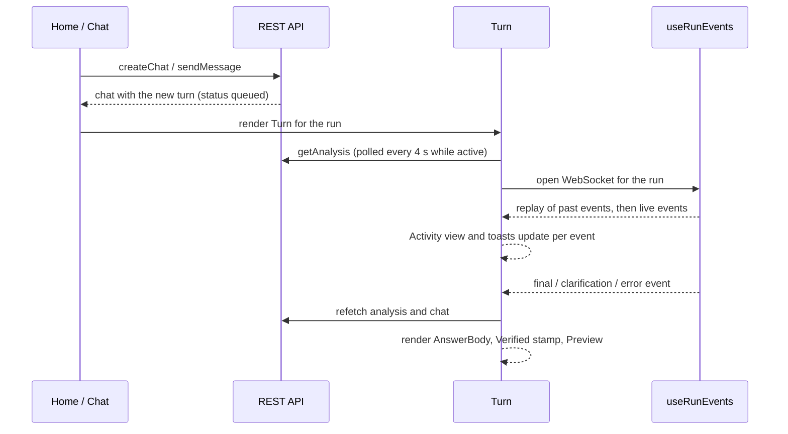

# Frontend

> **About this file:** how the web app in `frontend/` is built: stack, folder map, routes, how it talks to
> the API and WebSocket, how a question turns into an answer on screen, browser storage, and how to run,
> test and serve it. The backend it talks to is in [ARCHITECTURE.md](ARCHITECTURE.md).

## 1. Stack

| Part | Choice | Notes |
|---|---|---|
| UI | React 18 + TypeScript, built with Vite 7 | `npm run build` = `tsc -b && vite build` |
| Styling | Tailwind 4 (`@tailwindcss/vite`), tokens in `src/index.css` | Fonts are self-hosted (IBM Plex Sans, Source Serif 4), so the offline demo looks the same |
| Components | Small wrappers over Radix primitives in `src/components/ui/` | Dialog, sheet, tabs, tooltip, toast, dropdown, switch and others, exported from `ui/index.ts` |
| Server state | TanStack react-query | REST data, caching, polling while a run is active |
| Routing | react-router-dom 7 | `Chat` and `RunActivity` are lazy-loaded to keep the first screen small |
| Charts | Plotly (`plotly.js-basic-dist-min` via `react-plotly.js`) | Renders the Plotly figure the backend sends; about 1.1 MB, loaded on demand |
| Markdown | `react-markdown` + `remark-gfm` | Report text |
| Tests | Vitest + Testing Library on jsdom | Setup in `src/test/setup.ts` |

## 2. Folder map

```
frontend/
├── src/
│   ├── main.tsx            providers: react-query, tooltip, toast, router; font imports
│   ├── App.tsx             token gate, shell, routes
│   ├── pages/              Home, Chat, RunActivity
│   ├── components/         app components (Turn, ChatBar, Sidebar, PreviewPanel, ...)
│   │   └── ui/             Radix-based primitives (button, card, dialog, tabs, toast, ...)
│   ├── lib/                API client, types, WebSocket hook, pure helpers, fixtures
│   └── test/setup.ts       Vitest setup
├── nginx.conf.template     serves the build and proxies /api and /ws in Docker
├── Dockerfile              node build stage, then nginx runtime
└── vite.config.ts          dev server proxy, Tailwind, Vitest config
```

## 3. Routes and pages

| Route | Page | What it does |
|---|---|---|
| `/` | `Home` | Start page: wordmark, one chat bar, sample questions from `GET /public-config`. Sending creates a chat (`POST /chats`) and navigates to it |
| `/chats/:id` | `Chat` | The conversation: one `Turn` per question, the chat bar at the bottom, and an optional preview panel |
| `/activity` | `RunActivity` | Every run across all chats: totals per week, month or year, and the runs in a period |
| `/analyses/:id` | `LegacyRun` | Old single-run links; redirects to the chat that holds the run |
| `/history`, anything else | n/a | Redirect to `/` |

Everything sits inside `TokenGate` (see section 7) and `ChatShell` (collapsible sidebar, Settings button
on every page; the sidebar becomes a drawer at phone width).

## 4. Talking to the backend

All HTTP goes through one client, `src/lib/api.ts`. Its `request()` helper adds the access token header,
turns error responses into an `ApiError` with the server's `detail` text, and handles `204`.

| Area | `api` functions | Endpoint family |
|---|---|---|
| Config | `publicConfig`, `config` | `/api/v1/public-config`, `/config` |
| Chats | `createChat`, `getChat`, `listChats`, `renameChat`, `pinChat`, `deleteChat` | `/api/v1/chats` |
| Turns | `sendMessage`, `retryTurn` | `/chats/{id}/messages`, `/chats/{id}/turns/{n}/retry` |
| A run | `getAnalysis`, `summary`, `events`, `clarify`, `cancel`, `rerun`, `remove` | `/api/v1/analyses/{id}...` |
| Run history | `activity`, `activityRuns` | `/api/v1/activity` |
| Demo | `chaos`, `setChaos` | `/api/v1/admin/chaos` (disabled on AWS) |
| Export | `exportUrl(id, format)` | a link the browser opens, not a fetch |

Response types are in `src/lib/types.ts` and mirror the backend's models.

Two details worth knowing:

- The token is sent as `X-Access-Token`, not `Authorization`, because CloudFront only forwards
  `Authorization` when it is part of the cache key.
- Browsers can't set headers on a WebSocket or a download link, so `wsUrl()` and `exportUrl()` put the token
  in a `token=` query parameter.

## 5. From question to answer



Key pieces:

- **`Turn`** (`components/Turn.tsx`) shows one question and its answer. A retry adds a *version* of the same
  turn; the newest is shown and an "Answer 1 of 2" switch reaches earlier ones. While the run is active it
  polls `getAnalysis` and listens to events; the stored result replaces the live view when the run ends.
- **`useRunEvents`** (`lib/useRunEvents.ts`) opens `/ws/analyses/{id}?after=<seq>`. It ignores `ping`
  messages and any event whose `seq` it has already seen. If the socket drops while the run is active it
  reconnects with exponential backoff (2 s, 4 s, ... capped at 10 s) and asks for events after the last
  `seq`, so the timeline has no gaps. The first replay is history; `liveAfter` marks where history ends.
- **`Activity`** (`components/Activity.tsx`, `lib/activity.ts`, `lib/stages.ts`) turns raw events into plain
  language: one line while running, a seven-stage summary (Interpret, Plan, Extract, Quality, Analyse,
  Write, Verify) when done, and a dialog with "Main steps" or "Every action" plus the raw JSON under
  "Technical details". The progress bar never moves backwards on a re-plan or rewrite.
- **`useRunToasts`** toasts only events that happen while the page is open (fallbacks, failed drafts,
  errors, the final status), never the replayed history.
- **`ClarificationCard`** appears when the run is `awaiting_input`. Answering calls `clarify`, and the same
  run resumes. The chat bar switches to "Your answer" while a question is open.
- **Follow-ups:** the suggested questions under the last answer come from the backend
  (`result.suggestions`); clicking one calls `sendMessage`. The backend carries sector, metric and years
  over from earlier turns.

## 6. The answer and the preview panel

| Component | Shows |
|---|---|
| `AnswerBody` (`ResultPanels.tsx`) | The answer in the chat: summary, key findings, rest of the verified report |
| `VerifiedStamp` | A quiet "verified" mark; the check rates are in its tooltip |
| `PreviewPanel` | Tabs **Report**, **Charts**, **Data & quality**, **Plan**, plus Export. A side panel on desktop, a full-screen sheet on mobile |
| `PlotlyChart` | The backend's Plotly figure with the app's theme applied (`darkLayout`) |
| `RunDetails` | A plain-language dialog of facts about one run, opened from "Run details" and from `/activity`. The short version of what Langfuse shows engineers |
| `lib/evidence.ts` | `markCitedNumbers` highlights numbers in a claim that match a cited fact (best effort; unmatched phrasing is left unmarked) |

Export (PDF, Word, Markdown, JSON, CSV, HTML) is a plain link from `exportUrl`; the backend builds the file.

## 7. Access token and browser storage

`TokenGate` shows a passphrase screen only when `GET /public-config` says `token_required` (the deployed
AWS app sets `APP_ACCESS_TOKEN`). Local runs skip it.

Everything stored in the browser is a convenience; the app works without it:

| Key | What | Where |
|---|---|---|
| `policy-analytics-token` | The access token | `lib/api.ts` |
| `owl-message-options` | Web context on/off and model choice (`auto`, `openai`, `gemini`) for the next question | `lib/useMessageOptions.ts` |
| sidebar open/closed | Sidebar state | `components/shell.tsx` |

All reads and writes are wrapped in `try/catch`, so a blocked or private-mode browser falls back to
in-memory values for that page.

## 8. Settings and demo toggles

The Settings button (every page) opens `SettingsDialog`: system status (the LLM chain and tracing status,
from `GET /config`) and `DemoControls`. The demo toggles (simulate a source or LLM outage, inject a hallucination) call the admin
chaos endpoint. They are disabled on the AWS deployment (`APP_ENV=aws`), and the dialog says so.

## 9. Run, build and test

From the repo root (Makefile) or `frontend/` (npm):

| Task | Command |
|---|---|
| Install | `make install`, or `npm ci` in `frontend/` |
| Dev server with hot reload | `make dev-web`, or `npm run dev` (http://localhost:5173) |
| Type check | `npm run typecheck` |
| Lint | `npm run lint` |
| Tests | `npm test` (Vitest, once) |
| Production build | `npm run build` (output in `frontend/dist`) |

The dev server proxies `/api`, `/healthz`, `/readyz` and `/ws` to `http://localhost:8000`. Point it
elsewhere with `API_UPSTREAM=http://host:port npm run dev`. Start the backend first (`make dev-api`).

**Tests** sit next to the code they test:

| Area | Files |
|---|---|
| Pure logic on recorded data | `lib/activity.test.ts`, `lib/evidence.test.ts`, `lib/chats.test.ts`, `lib/logic.test.ts` (fixture: `lib/fixtures/runs.json`) |
| WebSocket hook | `lib/useRunEvents.test.ts` |
| Components and pages | `components/chat.test.tsx`, `components/ClarificationCard.test.tsx`, `components/ui/ui.test.tsx`, `pages/RunActivity.test.tsx` |

CI runs lint, tests and the build on every push and pull request (see [ARCHITECTURE.md §10](ARCHITECTURE.md)).
Browser end-to-end tests (Playwright) are not set up; see [TESTING.md](TESTING.md) §10.

## 10. How it is served

The `Dockerfile` builds the app with Node 22, then copies `dist/` into an `nginx:1.30-alpine` image. The
built files are **baked into the image**, so a frontend change needs an image rebuild (`make up` does it
with `--build`).

| Where | Who routes `/api` and `/ws` |
|---|---|
| Docker Compose (port 8080) | nginx proxies them to `API_UPSTREAM` (default `http://api:8000`); WebSocket upgrade headers and a 1-hour read timeout are set |
| AWS | The ALB routes them straight to the api service; nginx only serves the static app |

Caching: `/assets/` (hashed filenames) is cached for 30 days; `index.html` and SPA routes are `no-cache`,
so a new deploy is picked up on the next visit.
