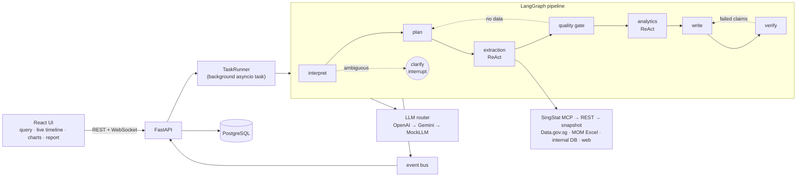

# Agentic Policy Data Analytics Platform

A policy researcher asks a question in plain English, e.g. *"Analyse employment trends in the technology
sector from 2020-2024"*. A team of agents plans the work, pulls official data from Singapore government
sources, checks and cleans it, computes the statistics, and writes a cited report. The researcher watches
every reasoning step live, and every number in the report is checked against the computation that
produced it before the report is shown.

**Core principle: the LLM reasons, code computes.** Models choose datasets, tools and wording; every
number comes from a deterministic Python function and is stored as a numbered *Fact*. A verifier rejects
any claim whose numbers, citations, years or sectors don't match those Facts.

| | |
|---|---|
| Agents | Coordinator (interpret, plan, re-plan, clarify) · Extraction (ReAct) · Analytics (ReAct) · Report Writer · Verifier |
| Data | **SingStat via DOS's official MCP server** (REST API and snapshot fallbacks) · Data.gov.sg (CSV) · MOM (Excel) · mock internal systems (SQL) · the web (HTML, with trust tiers) |
| LLMs | OpenAI and Google Gemini behind one router: per-task model tiers, fallback chain, circuit breaker, per-run budget cap, cost tracking. A scripted MockLLM makes the whole app run with no keys |
| Stack | FastAPI + LangGraph · PostgreSQL · React 18 + TypeScript (Vite) · Plotly · Gotenberg (PDF) · Docker Compose · GitHub Actions · Terraform for AWS ECS Fargate |

More detail: [ARCHITECTURE.md](ARCHITECTURE.md) · [DATA_SOURCES.md](DATA_SOURCES.md) ·
[TESTING.md](TESTING.md) · [DEPLOYMENT.md](DEPLOYMENT.md) · [INNOVATION.md](INNOVATION.md)

## Architecture at a glance



## Quick start (Docker, no keys needed)

Prerequisites: Docker Desktop (or Docker Engine with Compose v2).

macOS (Intel or Apple Silicon), using [Homebrew](https://brew.sh):

```bash
brew install --cask docker     # Docker Desktop; open it once and wait until it says "running"
brew install git make          # make is only needed for the Makefile shortcuts
```

The commands below are the same on macOS, Linux and Windows (Git Bash).

```bash
git clone https://github.com/weikiat98/tech-assignment.git
cd tech-assignment
cp .env.example .env          # works as-is: placeholders mean "not configured"
docker compose up -d --build  # postgres, gotenberg, migrate, api :8000, frontend :8080
```

Open **http://localhost:8080** and pick a sample question. With placeholder keys the agents run on the
scripted MockLLM, so the whole flow works offline from LLM providers, using real government data.

- API docs: http://localhost:8000/docs · health: `/healthz`, `/readyz`
- Stop: `docker compose down` (add `-v` to drop the database)

### Turning on real LLMs, tracing and web search

Edit `.env` and restart the api (`docker compose up -d api`). Any value still starting with `REPLACE_ME`
counts as not configured.

| Setting | Effect |
|---|---|
| `OPENAI_API_KEY`, `GOOGLE_API_KEY` | Live LLMs; `LLM_PROVIDER_ORDER=openai,gemini` sets the fallback order |
| `LLM_MODE` | `auto` (live when keys exist, else mock) · `mock` · `live` (no mock fallback) |
| `RUN_LLM_BUDGET_USD` | Per-analysis spend cap; past it the run finishes on MockLLM and says so |
| `LANGFUSE_PUBLIC_KEY`, `LANGFUSE_SECRET_KEY`, `LANGFUSE_BASE_URL` | Trace every node, LLM call and tool call in Langfuse |
| `TAVILY_API_KEY` | Tavily web search (otherwise keyless DuckDuckGo; `WEB_SEARCH_PROVIDER=mock` for fixtures) |
| `OFFLINE_MODE=true` | Serve every source from the recorded snapshots in `backend/data/snapshots/` |
| `APP_ACCESS_TOKEN` | Require a shared token on `/api` and `/ws` (set it on any public deployment) |

> System-wide `OPENAI_API_KEY`/`GOOGLE_API_KEY` variables (Windows environment variables, or `export`s in
> your macOS `~/.zshrc`) are picked up by a locally run backend (not by Docker, which only reads `.env`).
> Set `LLM_MODE=mock` while developing to avoid spend.

## Local development (without Docker)

Prerequisites: [uv](https://docs.astral.sh/uv/) for the backend and Node 22 (22.12 or newer) for the frontend.
macOS: `brew install uv node@22`. Windows: `winget install astral-sh.uv OpenJS.NodeJS.LTS`. uv reads
`backend/.python-version` (3.12) and downloads that Python if it isn't installed. Backend dependencies are
declared in `backend/pyproject.toml` and pinned in `backend/uv.lock`, so every machine, CI and the Docker
image install the same versions.

```bash
# backend: the commands are the same on macOS, Linux and Windows
cd backend
uv sync                                      # creates .venv from uv.lock, dev tools included
uv run uvicorn app.main:app --reload --port 8000

# frontend: Node 22
cd frontend
npm install
npm run dev                                  # http://localhost:5173, proxies /api and /ws to :8000

# one analysis in the terminal
cd backend && uv run python -m app.cli "Analyse employment trends in the technology sector from 2020-2024"
```

The `Makefile` wraps these (`make install`, `make up`, `make dev-api`, `make dev-web`, `make cli Q="..."`,
`make test`, `make lint`, `make load-stack && make load`, `make aws-*`). Backend targets run through
`uv run`, so the same targets work on every platform.

To add or upgrade a backend dependency: `uv add <package>` (or `uv add --dev <package>`), or
`uv lock --upgrade-package <package>`, then commit `pyproject.toml` and `uv.lock` together. There is no
`requirements.txt`: `pyproject.toml` declares the dependencies and `uv.lock` pins them. If a tool needs
one, generate it with `uv export --no-dev --format requirements-txt`.

## Running the tests

```bash
cd backend
uv run pytest -m "not contract and not llm" --cov=app      # 164 tests, about a minute, offline, no keys
uv run pytest tests/eval -s                                 # prints the hallucination-detection table
uv run ruff check app tests
cd ../frontend && npm run lint && npm run typecheck && npm test && npm run build   # 41 Vitest tests
make load-stack && make load                                       # Locust: 50 users for 2 minutes
```

Tests force the MockLLM, recorded snapshots and a throwaway SQLite database, so they never call a paid
API. Results, coverage and the hallucination methodology are in [TESTING.md](TESTING.md).

## Sample queries

| Query | Shows |
|---|---|
| Analyse employment trends in the technology sector from 2020-2024 | Main demo: SingStat (MCP), MOM Excel and Data.gov.sg; quality checks; levels, CAGR, YoY, trend, share; 3 charts |
| Compare employment growth across sectors from 2019 to 2024 | Multi-sector comparison |
| Why did retrenchments in the technology sector rise in 2023? What did MOM say? | Web search with trust tiers; quarterly data annualised (complete years only) |
| How did workforce training programme enrolments relate to placements in the tech sector from 2019-2024? | Internal SQL source; Pearson/Spearman correlation with a small-sample caveat |
| Forecast technology sector employment for the next two years | Linear projection with a 95% interval, labelled as a projection |
| How is the job market doing? | Ambiguous: the Coordinator pauses and asks for clarification, then resumes |

**Demo controls** in the Settings dialog (header button) simulate failures for the next run: SingStat MCP down (falls back to
the REST API), SingStat REST down too (falls back to recorded snapshots), Data.gov.sg down, OpenAI down
(falls back to Gemini), and *inject a hallucination* (the verifier catches it and the writer rewrites).
The toggles are disabled automatically on shared deployments (`APP_ENV=aws`).

## Technology choices

| Choice | Why |
|---|---|
| **LangGraph** | An explicit state graph is easy to reason about and explain; conditional edges give re-planning and the verify/rewrite loop; `interrupt` + checkpointing give clarification and resume |
| **Provider-neutral ReAct** (structured `ReActStep` JSON) | The same loop runs on OpenAI, Gemini and the MockLLM, and every Thought/Action/Observation is an explicit event for the timeline |
| **Own LLM router** over LangChain chat models | Control over fallback order, circuit breaking, per-task tiers, budget caps and cost logging, plus a deterministic mock for tests |
| **SingStat MCP** as primary SingStat access | DOS's own MCP server: discovery, metadata and data through a standard protocol; REST and snapshots behind it |
| **FastAPI** | Async-native, WebSockets, Pydantic schemas shared with the LLM's structured outputs, OpenAPI docs |
| **In-process TaskRunner + event bus** | Fewest moving parts for one replica; small interface so arq + Redis can replace it to scale out |
| **PostgreSQL** (pgvector image) | Runs, events, facts, charts, reports and LLM-call logs; pgvector ready for RAG |
| **pandas / SciPy**, plain checks | Every statistic and quality rule is explicit and unit-tested |
| **React + TypeScript (Vite)** | The brief names TypeScript; a static SPA behind nginx needs no SSR |
| **Plotly** | The backend emits chart specs as data, so charts are testable, exportable and rendered identically in the UI and PDF |
| **Gotenberg** for PDF | Headless Chromium renders the interactive Plotly charts; keeps PDF libraries out of the API image |
| **Terraform → ECS Fargate + CloudFront** | Same containers as Compose, HTTPS without buying a domain, OIDC deploys with no stored AWS keys |

## Repository layout

```
backend/   FastAPI app (app/), tests/, recorded snapshots (data/), Dockerfile
  app/agents/        LangGraph graph, ReAct loop, prompts, scripted MockLLM policies
  app/tools/         tools the agents call (extraction, analytics)
  app/sources/       SingStat MCP/REST, Data.gov.sg, MOM Excel, internal DB adapters
  app/analytics/     deterministic statistics and Plotly chart builders
  app/verification/  anti-hallucination checks
  app/llm/           router, providers, costs
  app/web/           search providers, SSRF-safe fetch, grounding, trust tiers
frontend/  React + TypeScript SPA, nginx config, Dockerfile
infra/     Terraform for AWS (ECS Fargate, RDS, ALB, CloudFront) and deploy/pause scripts
.github/   CI (lint, tests, coverage, build, compose smoke test), the ECS deploy workflow and a monthly
           CVE scan (pip-audit, npm audit, Trivy; see TESTING.md §9)
```
